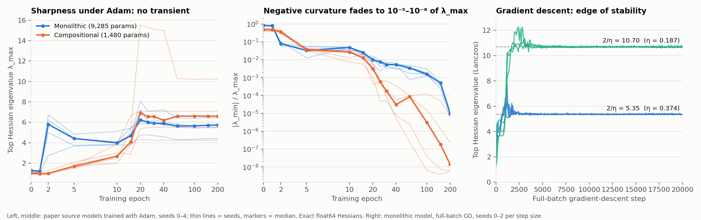

# Optimizer mathematics and curvature dynamics: results

Protocol: [`curvature_protocol.md`](curvature_protocol.md) (frozen at
`9368482`, amended before any run). Tests: `research/tests/test_optimizer_maths.py`
(Part A), `research/tests/test_curvature_dynamics.py` (harness). Harness:
`research/experiments/curvature_dynamics.py`. Raw results:
`research/results/curvature_dynamics_v1.json`.

## Summary

- **The optimizer identities hold, with one correction.** Nine of the ten
  Part A claims hold to float64 tolerance. "Muon sets every singular value to
  1" is wrong for the quintic Newton–Schulz iteration that Muon actually uses.
- **The Hessian shows no transient.** In the source models the top Hessian
  eigenvalue rises early and then stays flat. It never rises and then falls
  the way the observer latent's clustering does (0/5 seeds per model). This
  agrees with the ablation result that the transient is a property of the
  observer, not of the networks it watches.
- **Negative curvature is everywhere early and negligible late.** At
  initialization, 44–48% of the Hessian's eigenvalue mass is negative. By
  epoch 200, the most negative eigenvalue is 10⁻⁵ of λ_max (monolithic) to
  10⁻⁸ (compositional).
- **The gradient lives in the top few eigendirections.** After epoch 5, at
  least half the gradient's squared norm lies in the top-10 eigenspace at
  97 of 100 checkpoints.
- **Full-batch gradient descent sits exactly at the edge of stability.**
  Sharpness rises 4–8× from initialization and settles within 0.4% of 2/η,
  in 6 of 6 runs.



## Part A — identities

| Claim | Result |
|---|---|
| A1. Pearlmutter HVP is exact | Holds, matching the full Hessian to 1e-12 |
| A2. One HVP costs about two backward passes | Median HVP/gradient time ratio is **2.67** on the paper monolithic model (CPU, one thread, 200 repetitions) |
| A3. Newton's method is attracted to saddles | Holds. One step lands on the saddle of x² − y², and with an indefinite Hessian the Newton direction can point uphill |
| A4. Gauss–Newton is PSD; the Hessian is not | Holds. H = JᵀJ·2/n + residual term exactly; the Gauss–Newton part has no negative eigenvalue while H has some |
| A5. Adam without averages is sign descent | Holds exactly |
| A6. sign(g) is steepest descent under ℓ∞ | Holds |
| A7. UVᵀ is steepest descent under the spectral norm | Holds |
| A8. Newton–Schulz approximates UVᵀ | **Partly wrong; see below** |
| A9. Muon is Shampoo without accumulation | Holds exactly, for square and rectangular matrices |
| A10. AdamW decay is decoupled | Holds. `torch.optim.AdamW` matches the decoupled formula; Adam with `weight_decay` gives a different step |

**A8 correction.** The quintic coefficients (3.4445, −4.7750, 2.0315) in
`research/optimizers/muon.py` keep the gradient's singular vectors but do not
drive its singular values to 1:

- On a 64×32 matrix they land in about [0.68, 1.13]. This is inside the
  pre-registered [0.5, 1.5] band.
- On a square 256×256 random matrix, the smallest singular values stay
  small, down to about 0.005. This is outside the band. The prediction did
  not anticipate that near-zero singular values are not lifted in five steps.

The classic cubic iteration does converge to UVᵀ. So the accurate statement
is "Muon roughly equalizes the singular values of the update, except
directions with almost no gradient", not "sets them all to 1".

## Part B — curvature dynamics

Paper source models trained with Adam as in `models/delta_observer.py`,
without the observer (seeds 0–4). Exact float64 Hessian of the full-batch
MSE loss at 14 checkpoints per run: 140 Hessians in all. Hessian asymmetry
before symmetrization was below 5e-15 everywhere. Both models reach and keep 100%
accuracy by epoch 15–30 in every seed.

### Prediction 1 — no top-eigenvalue transient: **held (5/5 mono, 5/5 comp)**

| Model | λ_max at epoch 0 | Peak (epoch) | λ_max at epoch 200 |
|---|---|---|---|
| Monolithic | 1.11–1.34 | 4.77–8.07 (epochs 2–25) | 4.40–6.46 |
| Compositional | 0.91–1.20 | 4.31–15.52 (epochs 20–40) | 4.25–10.21 |

The largest drop from peak is compositional seed 2, from 15.5 to 10.2. That
is 66% of its peak, not below the 50% threshold.

The monolithic model does have a sharp early event. Between epochs 1 and 2,
during learning-rate warmup, λ_max jumps from about 1.2 to 2.7–6.7. The top-5
eigenspace turns over almost entirely: the overlap with epoch 1 is 0.20–0.45,
against 0.56–1.00 at every other step. At epoch 2, the top eigenvector alone
holds 30–99% of the gradient. λ_max then eases to 3.7–4.8 by epoch 5 and
climbs again as the model fits.

This early event is a curvature reorganization, not a rise and fall. It also
happens long before the observer's clustering peaks.

### Prediction 2 — negative eigenvalues at every checkpoint: **held, but only literally**

Every one of the 140 Hessians has negative eigenvalues. The *count* of
negative eigenvalues stays high throughout: 3,633–3,691 of 9,285 (mono) and
716–723 of 1,480 (comp) at epoch 200. The count, though, is the wrong
measure of how much negative curvature there is.

Near zero loss, the Gauss–Newton part has a large null space. The residual
term, whose size scales with the residuals, splits that space roughly evenly
into tiny positive and negative eigenvalues. What matters is the magnitude:

| | Epoch 0 | Epoch 200 |
|---|---|---|
| Negative share of eigenvalue mass (mono) | 0.48 | < 0.001 |
| \|λ_min\| / λ_max (mono) | 0.80–0.85 | 6e-6 to 1.2e-5 |
| \|λ_min\| / λ_max (comp) | 0.41–0.58 | 4e-9 to 7e-6 |

All these values are far above the float64 eigensolver noise floor (about
1e-11 here), so they are real. They are also irrelevant to optimization.
The models end in wide, almost flat valleys, not at saddles.

**Newton's direction in practice (measured, not predicted).** The
pseudo-inverse Newton direction −H⁺g (|λ| < 1e-8 dropped) was a *descent*
direction at only 12 of the 140 checkpoints. Everywhere else it pointed
uphill. A3 in practice: an unmodified Newton step on these networks usually
moves toward a saddle or maximum, steered by small eigenvalues of either
sign.

### Prediction 3 — gradient in the top-10 eigenspace: **held**

After epoch 5, at least half of ‖g‖² lies in the top-10 eigenspace at:

- 50 of 50 monolithic checkpoints.
- 47 of 50 compositional checkpoints.

The three exceptions (top-10 shares of 0.48, 0.48 and 0.10) are all
compositional; the 0.10 is at epoch 200, where that gradient is 1e-6. This extends Gur-Ari et al.'s
observation to MSE with Adam on this task, which the protocol flagged as
uncertain.

### Prediction 4 — edge of stability: **held (3/3 seeds at both step sizes)**

Full-batch gradient descent on the monolithic model, λ₀ = 1.337 (seed 0 at
initialization), for 20,000 steps:

| η | 2/η | Peak sharpness | Median sharpness, last quarter | Ratio to 2/η |
|---|---|---|---|---|
| 0.374 | 5.35 | 6.24–7.69 (steps 1,000–1,700) | 5.345–5.368 | 0.999–1.004 |
| 0.187 | 10.70 | 11.19–12.27 (steps 2,800–3,600) | 10.659–10.712 | 0.996–1.001 |

The sequence is the same in all six runs:

1. Progressive sharpening of 4–8×.
2. A brief overshoot above 2/η.
3. A long plateau pinned at 2/η.

The loss falls from about 0.5 to about 5e-5 (larger η) or 1.2–1.6e-4
(smaller η), but
not monotonically: 35–43% of the 100-step intervals end higher than they
started. This is Cohen et al.'s edge-of-stability regime, reproduced on a
9,285-parameter model, and the agreement with 2/η is much tighter than the
±20% that was predicted.

## What this does and does not say

- **The transient belongs to the observer.** Neither curvature (here) nor
  the sources' activations (ablation addenda A and B) shows the observer's
  rise-and-fall. This is a third, independent measurement pointing the same
  way.
- **Adam does not run at raw edge of stability here.** At its peak learning
  rate (1/137), 2/η would be 274, about 50× the measured sharpness. Adam's
  stability depends on the *preconditioned* sharpness, which was not
  measured. So the gradient-descent result says what the loss surface does
  under plain gradient descent, not what the paper's training did.
- **Exact Hessians are feasible only at this size.** One monolithic
  checkpoint takes 100–150 s single-threaded, mostly the eigendecomposition.
  For large models, the practical tools are HVPs at about 2.7 gradients each
  (A2), Lanczos for the top few eigenvalues, and Gauss–Newton or
  Shampoo-style approximations that discard negative curvature (A4, A9).
- **Scope.** One toy task, 5 seeds (3 for EoS), small MLPs. Nothing here
  shows the measurements transfer to other tasks or larger models.

## Reproduce

Paper environment (root `requirements.txt`), from the repository root:

```bash
python -m unittest research.tests.test_optimizer_maths research.tests.test_curvature_dynamics
python -m research.experiments.curvature_dynamics --workers 3   # ~35 min on 3 cores
python -m research.experiments.plot_curvature_dynamics
```

## Addendum — block structure (exploratory, not pre-registered)

Prompted by the results above and run afterwards; no predictions were frozen.
Harness: `research/experiments/curvature_structure.py`; tests:
`research/tests/test_curvature_structure.py`; raw results:
`research/results/curvature_structure_v1.json`. Seeds 0–2, same checkpoints.
Blocks are the top-level modules: the four full adders (compositional) or the
four layers (monolithic). "Within share" is the fraction of the Hessian's
squared Frobenius norm inside the diagonal blocks.

### Compositional model: local curvature, coupled while learning

| Seed | Within share, epoch 0 | Minimum (epoch) | Epoch 200 | Block-only λ_max / full λ_max, epoch 200 | Final loss |
|---|---|---|---|---|---|
| 0 | 0.99 | 0.74 (20) | 0.78 | 0.67 | 8e-15 |
| 2 | 0.99 | 0.82 (15) | 0.87 | 0.95 | 4e-10 |
| 1 | 0.99 | 0.85 (10) | 0.88 | 0.98 | 6e-7 |

A random four-way split would give 0.25. The near-total locality at
initialization follows from the wiring: modules touch only through the carry.
Coupling rises while the carry chain is learned, then partly recedes. The
seed that fit most tightly kept the most coupling, in all three seeds; three
seeds fall in a given order by chance one time in six.

### Monolithic model: curvature starts between layers

Within-layer share is 0.03 at initialization against a 0.41 random baseline,
then 0.47–0.50 at epoch 200. The cause is exact and already known:

Write `H = G + R`, with `G` the Gauss–Newton part (positive semi-definite) and
`R` the residual part weighted by the errors. Inside one linear region, a ReLU
network's output is linear in each layer's parameters taken alone, so `R` is
zero on every within-layer block ("block-hollow"; Singh, Bachmann & Hofmann,
NeurIPS 2021; Singh, Hofmann & Schölkopf, ICML 2023). The exact within-layer
blocks of `H` therefore equal those of `G`, which also follows from the layer
recursion in Botev, Ritter & Barber (ICML 2017).

| Monolithic, seeds 0–2 | Epoch 0 | Epoch 2 | Epoch 20 | Epoch 200 |
|---|---|---|---|---|
| ‖R‖ / ‖H‖ | 0.97–0.98 | 0.36–0.41 | 0.03–0.07 | < 0.001 |
| Within-layer share of `R` | ≤ 2e-29 | ≤ 2e-29 | ≤ 1e-27 | ≤ 1e-23 |
| Within-layer share of `G` | 0.60–0.65 | 0.58–0.62 | 0.41–0.47 | 0.47–0.50 |
| Negative / positive eigenvalues of `R` | 3,000–3,117 each, equal | equal ± 1 | equal ± 2 | equal |

Because `R` has zero diagonal blocks it has zero trace, so its eigenvalues
sum to zero; the counts of negative and positive eigenvalues came out equal
(to within 2) at every checkpoint. At initialization `R` is 97% of `H`, which
explains the "half the eigenvalues are negative" result in Part B. As the
errors shrink, `R` vanishes and `H` becomes `G`.

In the compositional model each adder has three layers, so `R` is not zero
within a module; it is 98–99% within-module at initialization and falls to
0.17–0.51 by epoch 200, by which point `R` is under 0.1% of `H`.

### What this adds

Nothing here is new as mathematics; the zero blocks and the equality of
within-layer Hessian and Gauss–Newton blocks are known. New for this
repository: the coupling between modules is measurable, concentrated on the
carry, and largest while the carry chain is being learned. That observation
motivated [`second_star_slip.md`](second_star_slip.md).

```bash
python -m unittest research.tests.test_curvature_structure
python -m research.experiments.curvature_structure --workers 3   # ~40 min on 3 cores
```
