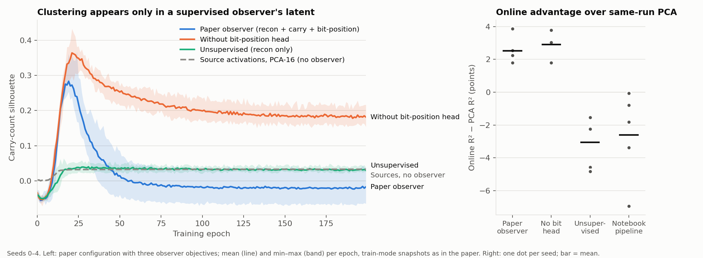

# Transient-clustering factor ablation: results

Protocol: [`scaffolding_ablation_protocol.md`](scaffolding_ablation_protocol.md)
(v1 frozen at `5cf9b33`; addenda A and B frozen before their runs at `44d9197`
and `1325a4f`). Harness: `research/experiments/scaffolding_ablation.py`.
Raw results: `research/results/scaffolding_ablation_{v1,addendum_a,addendum_b}.json`.

## Summary

- **In the paper's own setup the effect is robust.** The paper configuration
  shows transient clustering in the observer latent on 5/5 seeds (peak
  0.29 → final −0.02), and no single one of the seven factors removes it.
- **The rise needs carry supervision of the observer; the fall needs its
  bit-position head.** An observer trained only to reconstruct shows almost
  no carry-count clustering (peak 0.05, 5/5 seeds). Removing only the
  bit-position classification head (a `sum(sum bits) mod 4` label the paper
  does not mention) leaves clustering in place (final 0.16–0.22, 5/5 seeds).
- **The source networks' own activations show no transient carry-count
  clustering**, measured without any observer: silhouette stays at about
  0.03, in the full activation space and in a 16-component PCA subspace,
  0/5 seeds. Carry count is still linearly readable from them (PCA-16 R²
  0.92–0.96 at epoch 20 and after).
- **The online observer's advantage over PCA depends on carry supervision.**
  Against PCA of the same run's activations it is +2.5 points (paper: +4.0,
  against PCA of separately trained models). Without supervision it is
  −1.5 to −4.8 points on every seed.

Within this repository's task, these results do not support reading the
observer's rise-and-fall as the *networks* building and then discarding
scaffolding ("The Big Discovery: Transient Clustering" and "The Semantic
Primitive is in the Trajectory", `paper/delta_observer_arxiv_v3.tex` lines
311–382). They are consistent with the
pattern arising from the observer's supervised objective.



## Validation

- The harness's paper configuration reproduces `models/delta_observer.py`
  bit for bit: every snapshot and the final latent
  (`test_paper_config_replicates_paper_pipeline_exactly`).
- Sweep snapshots run under an isolated RNG and are verified not to change
  training (`test_snapshots_do_not_perturb_training`).
- Configurations rerun in addenda A and B match their v1 runs exactly
  (15/15 and 10/10).
- Source accuracy reached 100% in 79 of 80 v1 runs; `N/mono` seed 1 ended
  with the compositional model at 93.8% (reported, not excluded).

## v1: one factor at a time (pre-registered)

Silhouette is carry-count silhouette of the observer latent, train-mode
snapshots as in the paper; mean ± SD over seeds 0–4. "Present" applies the
protocol rule (peak ≥ 0.10 and final < 0.5 × peak) in train / eval mode.

| Configuration | Present (train / eval) | Peak silhouette | Final silhouette | Online − PCA R² | Min source acc. |
|---|---|---|---|---|---|
| `P` | 5/5 / 5/5 | 0.293 ± 0.038 | -0.020 ± 0.039 | +2.5 ± 0.7 pts | 100.0% |
| `N` | 2/5 / 3/5 | 0.091 ± 0.030 | +0.041 ± 0.014 | -2.6 ± 2.4 pts | 100.0% |
| `P/data` | 5/5 / 5/5 | 0.356 ± 0.050 | -0.039 ± 0.029 | +2.3 ± 0.8 pts | 100.0% |
| `N/data` | 0/5 / 4/5 | 0.079 ± 0.009 | +0.045 ± 0.011 | -2.4 ± 1.3 pts | 100.0% |
| `P/loss` | 5/5 / 5/5 | 0.220 ± 0.018 | -0.026 ± 0.015 | +1.2 ± 0.7 pts | 100.0% |
| `N/loss` | 2/5 / 3/5 | 0.425 ± 0.050 | +0.224 ± 0.018 | +0.1 ± 0.2 pts | 100.0% |
| `P/schedule` | 5/5 / 5/5 | 0.301 ± 0.039 | -0.052 ± 0.018 | +4.4 ± 0.5 pts | 100.0% |
| `N/schedule` | 1/5 / 1/5 | 0.110 ± 0.021 | +0.073 ± 0.020 | -1.6 ± 0.7 pts | 100.0% |
| `P/mono` | 5/5 / 5/5 | 0.301 ± 0.028 | -0.047 ± 0.017 | +1.6 ± 0.4 pts | 100.0% |
| `N/mono` | 1/5 / 1/5 | 0.176 ± 0.048 | +0.111 ± 0.012 | -1.2 ± 0.8 pts | 93.8% |
| `P/comp` | 5/5 / 5/5 | 0.241 ± 0.047 | -0.030 ± 0.024 | -0.5 ± 0.2 pts | 100.0% |
| `N/comp` | 2/5 / 4/5 | 0.103 ± 0.006 | +0.051 ± 0.012 | -1.8 ± 0.6 pts | 100.0% |
| `P/observer` | 5/5 / 5/5 | 0.373 ± 0.039 | +0.128 ± 0.014 | +2.0 ± 0.9 pts | 100.0% |
| `N/observer` | 1/5 / 2/5 | 0.084 ± 0.014 | +0.041 ± 0.014 | -3.0 ± 1.5 pts | 100.0% |
| `P/batch` | 5/5 / 5/5 | 0.293 ± 0.031 | -0.026 ± 0.027 | +2.8 ± 0.8 pts | 100.0% |
| `N/batch` | 3/5 / 3/5 | 0.115 ± 0.023 | +0.054 ± 0.012 | -2.7 ± 1.4 pts | 100.0% |

**Decision rule.** From the paper baseline (5/5 present in both modes), no
single flip changes the classification, so the protocol attributes the
notebook's lack of the effect to an interaction and names no single factor.
From the notebook baseline, the classification itself is unstable (2/5
train, 3/5 eval); `N/schedule` and `N/mono` meet the letter of the rule in
eval mode (4/5 absent), but against a baseline at chance this is not
informative.

**Prediction** (`schedule` and `loss` matter most, `data` least): mostly
wrong. `schedule` barely matters; from the paper baseline it slightly
strengthens dissolution. `data` mattered least, as predicted.

**What the binary rule hides.** `P/observer` is classified "present" because
final < 0.5 × peak, yet its final silhouette stays at +0.12 to +0.15 on every
seed. That motivated addendum A. Dropout in the paper's snapshots lowers the
measured peak (eval-mode peaks 0.38–0.54) but does not create the dissolution.

## Addendum A: observer decomposition, observer-free measurement

| Configuration | Measurement | Present | Peak silhouette | Final silhouette |
|---|---|---|---|---|
| `P` | train | 5/5 | 0.293 ± 0.038 | -0.020 ± 0.039 |
| `P` | src_concat | 0/5 | 0.028 ± 0.005 | +0.028 ± 0.005 |
| `P` | src_mono | 0/5 | -0.007 ± 0.009 | -0.007 ± 0.009 |
| `P` | src_comp | 0/5 | 0.049 ± 0.009 | +0.048 ± 0.009 |
| `P/observer` | train | 5/5 | 0.373 ± 0.039 | +0.128 ± 0.014 |
| `P/observer` | src_concat | 0/5 | 0.028 ± 0.007 | +0.027 ± 0.008 |
| `P/observer` | src_mono | 0/5 | -0.004 ± 0.009 | -0.005 ± 0.009 |
| `P/observer` | src_comp | 0/5 | 0.049 ± 0.013 | +0.048 ± 0.013 |
| `N` | train | 2/5 | 0.091 ± 0.030 | +0.041 ± 0.014 |
| `N` | src_concat | 0/5 | 0.065 ± 0.011 | +0.058 ± 0.008 |
| `N` | src_mono | 0/5 | 0.028 ± 0.018 | +0.012 ± 0.022 |
| `N` | src_comp | 0/5 | 0.087 ± 0.015 | +0.076 ± 0.013 |
| `P/obs-nobit` | train | 3/5 | 0.373 ± 0.040 | +0.182 ± 0.020 |
| `P/obs-nobit` | src_concat | 0/5 | 0.028 ± 0.007 | +0.027 ± 0.008 |
| `P/obs-nobit` | src_mono | 0/5 | -0.004 ± 0.009 | -0.005 ± 0.009 |
| `P/obs-nobit` | src_comp | 0/5 | 0.049 ± 0.013 | +0.048 ± 0.013 |
| `P/obs-constlr` | train | 5/5 | 0.292 ± 0.040 | -0.025 ± 0.034 |
| `P/obs-constlr` | src_concat | 0/5 | 0.028 ± 0.005 | +0.028 ± 0.005 |
| `P/obs-constlr` | src_mono | 0/5 | -0.007 ± 0.009 | -0.007 ± 0.009 |
| `P/obs-constlr` | src_comp | 0/5 | 0.049 ± 0.009 | +0.048 ± 0.009 |

Predictions: bit-position head accounts for non-dissolution (`P/obs-nobit`
final > 0.08 in ≥ 4/5): **confirmed, 5/5** (0.16–0.22).
`P/obs-constlr` dissolves in ≥ 4/5: **confirmed, 5/5**. Sources show weaker
transient structure than the latent: **confirmed** (no transient clustering
in any source measurement, 0/5). In `P`, the concatenated-source silhouette
peaks at epochs 176–199 in 4 of 5 seeds, not around epoch 20.

## Addendum B: supervision and observer-free subspace

| Configuration | Measurement | Present | Peak silhouette | Final silhouette |
|---|---|---|---|---|
| `P` | train | 5/5 | 0.293 ± 0.038 | -0.020 ± 0.039 |
| `P` | src_pca16 | 0/5 | 0.033 ± 0.005 | +0.033 ± 0.004 |
| `P/obs-nobit` | train | 3/5 | 0.373 ± 0.040 | +0.182 ± 0.020 |
| `P/obs-nobit` | src_pca16 | 0/5 | 0.033 ± 0.007 | +0.032 ± 0.008 |
| `P/obs-unsup` | train | 0/5 | 0.046 ± 0.013 | +0.031 ± 0.006 |
| `P/obs-unsup` | src_pca16 | 0/5 | 0.031 ± 0.008 | +0.031 ± 0.008 |
| `N` | train | 2/5 | 0.091 ± 0.030 | +0.041 ± 0.014 |
| `N` | src_pca16 | 0/5 | 0.067 ± 0.011 | +0.060 ± 0.009 |

| Configuration | Online R² | Same-run PCA R² | Online − PCA (per seed, pts) |
|---|---|---|---|
| `P` | 0.989 ± 0.003 | 0.964 ± 0.006 | +2.1, +1.8, +3.9, +2.2, +2.5 |
| `P/obs-nobit` | 0.992 ± 0.005 | 0.963 ± 0.008 | +3.0, +1.8, +3.8, +3.0, +3.0 |
| `P/obs-unsup` | 0.927 ± 0.015 | 0.958 ± 0.012 | -1.5, -4.6, -2.2, -4.8, -2.2 |
| `N` | 0.960 ± 0.026 | 0.986 ± 0.005 | -1.8, -6.9, -3.4, -0.1, -0.8 |

Predictions: `P/obs-unsup` has `online_minus_pca ≤ 0` in ≥ 4/5: **confirmed,
5/5**; its peak silhouette < 0.10 in ≥ 4/5: **confirmed, 5/5**.
`src_pca16` in `P` has no transient clustering in ≥ 4/5: **confirmed, 5/5**.

## Notes on the paper's comparisons

- The paper's PCA baseline (`evaluate_online_vs_pca`, `compare_methods.py`)
  uses activations from separately trained legacy models
  (`data/delta_observer_dataset.npz`), not from the models the online
  observer watched. Against same-run PCA the advantage is +2.5, not +4.0
  points.
- The observer is trained to predict carry count (paper Algorithm 1), so the
  latent's carry-count R² is partly by construction. PCA is unsupervised.
- The observer's bit-position cross-entropy head is not described in the
  paper.

## Limits

One toy task, 5 seeds per configuration, silhouette as the only clustering
measure. Other notions of transient organization (probing over time,
representational similarity, intrinsic dimension) are untested and could
show structure that silhouette misses. If the supervised heads are taken as
part of the method, the findings reframe the effect as a property of the
supervised observer rather than refuting that the observer shows it.
Addenda A and B are post-hoc, motivated by v1, though each was frozen before
its own run.

## Reproduce

In the paper environment (root `requirements.txt`), from the repository root:

```bash
python -m unittest research.tests.test_scaffolding_ablation
python -m research.experiments.scaffolding_ablation --suite v1
python -m research.experiments.scaffolding_ablation --suite addendum-a
python -m research.experiments.scaffolding_ablation --suite addendum-b
python -m research.experiments.plot_scaffolding_ablation
```
