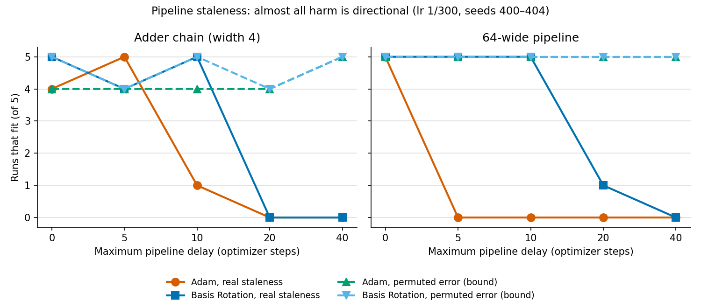

# Staleness in modular training: what we found

*Last updated 2026-10-29.* This is the single entry point to the
asynchronous-training work in this repository. Each finding is labelled:
- **Confirmed:** pre-registered, with a frozen protocol, run on fresh seeds.
- **Exploratory:** not pre-registered; seeds held apart from confirmation.
- **Killed:** failed its own criteria.

Everything here was measured on small networks of about 3k–18k parameters,
on 6-bit addition and random-automaton tasks. **Nothing has yet been tested
on a standard large architecture.**

*Under pipeline staleness, training with the real staleness error (solid
lines) fails beyond 5–10 steps of delay. With the same error's entries
scrambled (dashed lines, "the bound"), it trains up to 40. Basis Rotation
moves the real-error floor out to 10. Details:
[`pipeline_bound_v0.md`](pipeline_bound_v0.md).*

## Headline results

### 1. The permutation twin and the permutation bound (new tool)

Pair any training perturbation with its **permutation twin**: the same
perturbation, with each tensor's entries scrambled by a fixed random
permutation. The twin has the same norm, the same values and the same
correlation over time; only its alignment with the network is destroyed.
- **If the twin is harmless,** the harm is directional.
- **As a bound:** training with the twin is a ceiling for any method that
  corrects the error's direction. Delay-compensation methods can then be
  scored by how much of the stale-to-twin gap they close.

We did not find this control in the literature
([`prior_art_check_v0.md`](prior_art_check_v0.md),
[`stability_margin_v0.md`](stability_margin_v0.md)).

### 2. Staleness harm is directional (confirmed for Adam and SGD)

At delays the optimizer survives, the staleness error costs about 1.5–2× in
time to fit, and its permutation twin costs nothing measurable:
- Adam: 17 wins, 3 losses, p = 0.018;
- SGD: 19 wins, 1 loss, p = 7e-5;
- under Adam, also 20 wins, 0 losses in the first confirmation.

**Muon (lr 0.03):** not significant. That rate turned out to sit in an
oscillatory regime; see finding 6.

Sources: [`interface_confirm_v2_results.md`](interface_confirm_v2_results.md)
and [`interface_confirm_results.md`](interface_confirm_results.md).

**Mechanism (exploratory):** the real error points into sharp directions and
against the gradient.
- It sees 9–16× more curvature than its twin.
- Its cosine with the gradient reaches −0.8 under Adam after the learning
  transition.

See [`staleness_floor_v0.md`](staleness_floor_v0.md).

### 3. Under pipeline staleness, almost all harm is directional (exploratory)

Here stage k's gradient is computed at the whole model's weights from
earlier, its own weights included.
- **Real error:** Adam fails from delay 5–10.
- **Permutation twin:** trains at fresh speed up to delay 40, for both
  optimizers, both architectures and both learning rates.
- **Recovery against the bound:**

  | Method | Recovers |
  |---|---|
  | Basis Rotation (Jung, Shin & Lee, ICML 2026) | about ⅓ of the log-delay gap (floor 5 → 10, against a bound of at least 40) |
  | DC-ASGD, outer-product form | none (cross-stage model) |
  | Exact first-order Taylor correction | none, and it hurts (cross-stage model) |

At least 4× of tolerable delay is still unclaimed by any method tested.

Sources: [`pipeline_bound_v0.md`](pipeline_bound_v0.md),
[`basis_rotation_bound_v0.md`](basis_rotation_bound_v0.md) and
[`stability_margin_v0.md`](stability_margin_v0.md).

### 4. Excess interface width costs staleness tolerance (confirmed)

The architecture is held fixed (stages with their own inputs and outputs) and
only the width of the message between stages changes. A message just wide
enough for the task tolerates 16-step staleness far better than a 64-wide
one: 9/10 runs fit against 1/10 on the adder, and 9/10 against 3/10 on a
random automaton.

Sources: [`interface_confirm_results.md`](interface_confirm_results.md) and
[`interface_sweep_v0.md`](interface_sweep_v0.md).

### 5. Locality: local outputs help (exploratory)

Giving each pipeline stage its own output head beats a plain pipeline at
delay 4 on both tasks (10–0 and 5–0 seed pairs). Local *inputs* help on one
task only. Locality as a single factor was **not confirmed**.

Source: [`interface_confirm_v2_results.md`](interface_confirm_v2_results.md).

## Practical guidance (exploratory, consistent across experiments)

- **Tune asynchronous runs under staleness, not before it.** Tuning for
  synchronous speed picked learning rates in an oscillatory,
  edge-of-stability regime, where staleness tolerance collapses. That
  happened for every Muon-family optimizer
  ([`hybrid_staleness_v0.md`](hybrid_staleness_v0.md)).
- **The floor scales roughly with learning rate × delay. Momentum costs
  tolerance:** removing it doubled the floor
  ([`staleness_floor_v0.md`](staleness_floor_v0.md),
  [`stability_margin_v0.md`](stability_margin_v0.md)).
- **Diagonal DC-ASGD cannot correct cross-stage staleness,** because it has
  no cross-block terms. Exact first-order correction made ReLU networks
  worse.
- **Optimizers cross over with delay.**
  - Muon is fastest at small delays and Adam most tolerant at large ones.
  - An AdaMuon-style hybrid at a moderate learning rate covered both up to
    delay 16.
  - Basis Rotation helps under pipeline delay.

## Killed (each with its own report)

| Claim | Report |
|---|---|
| Local curvature tells you which interface to keep fresh (killed twice, with a repeatable target) | [`second_star_slip_results.md`](second_star_slip_results.md), [`second_star_slip_v2_results.md`](second_star_slip_v2_results.md) |
| The floor can be predicted without running to it. Four predictors failed under rules fixed in advance: linear sharpness theory, a block-structured model, a gradient descent ratio (too optimistic) and a closed-loop stress burst (too pessimistic) | [`stability_margin_v0.md`](stability_margin_v0.md) |
| Per-interface "decouple when settled" triggers beat a global switch | [`contract_experiments_v0.md`](contract_experiments_v0.md) |
| Discretized interfaces absorb staleness | [`contract_experiments_v0.md`](contract_experiments_v0.md) |
| Staleness induces modular structure | [`contract_experiments_v0.md`](contract_experiments_v0.md) |
| Correlated gradient noise helps learning. It helps fitting, not generalization | [`contract_experiments_v0.md`](contract_experiments_v0.md) |

## Prior art we build on

- **Delayed-gradient stability and learning-rate scaling with delay:**
  Giladi et al., ICLR 2020.
- **Hessian-eigenbasis misalignment as the cause of delay damage, and its
  fix:** Basis Rotation, ICML 2026.
- **DC-ASGD:** Zheng et al., ICML 2017.
- **Decoupled greedy learning:** Belilovsky et al., ICML 2020.
- **Edge of stability:** Cohen et al., 2021; Damian et al.
- **Anticorrelated noise injection:** Orvieto et al., ICML 2022.

Full list: [`prior_art_check_v0.md`](prior_art_check_v0.md) and
[`stability_margin_v0.md`](stability_margin_v0.md).

## Open questions

- **How does delay interact with edge-of-stability self-stabilization?** This
  is what actually sets the floor, and we found no work on it.
- **Does the permutation bound hold up on a standard architecture?** For
  example, a small transformer pipeline with weight stashing.
- **Does the pipeline result survive pre-registration?** Fresh seeds, more
  runs per cell.

## Reading order

1. This page.
2. [`pipeline_bound_v0.md`](pipeline_bound_v0.md): the bound in the
   pipeline setting.
3. [`interface_confirm_v2_results.md`](interface_confirm_v2_results.md): the
   confirmed directional result.
4. [`staleness_floor_v0.md`](staleness_floor_v0.md): the floor and its
   mechanism.
5. [`stability_margin_v0.md`](stability_margin_v0.md): why theory does not
   predict the floor, and first-order compensation against the bound.
